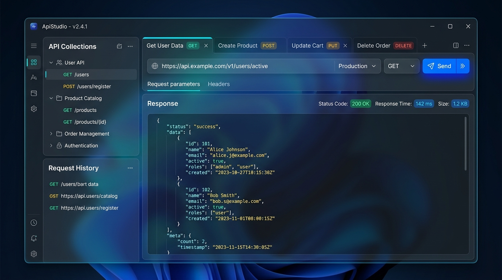

<p align="center">
  
</p>

<h1 align="center">ApiStudio</h1>

<p align="center">
  <strong>A modern, lightweight, frosted-glass API testing desktop client built with C# and .NET 8 WPF.</strong>
</p>

<p align="center">
  <a href="https://dotnet.microsoft.com/download/dotnet/8.0"></a>
  <a href="https://learn.microsoft.com/en-us/dotnet/desktop/wpf/"></a>
  <a href="#-architecture"></a>
  <a href="#-automated-testing"></a>
  <a href="#-license"></a>
</p>

<br />

<p align="center">
  
</p>

---

## 🌟 Overview

**ApiStudio** is a developer-first desktop REST client engineered for speed, privacy, and visual elegance. Inspired by Postman workflows, ApiStudio offers a completely offline, zero-telemetry API testing suite wrapped in a modern frosted glassmorphic UI.

No account sign-ups, no cloud syncing requirements, and no bloated background processes. Simply launch the app and start debugging APIs with instantaneous execution and local JSON persistence.

---

## ✨ Features

### 🎨 Frosted Glass Aesthetics & Dynamic Theming
* **Glassmorphic Design:** Translucent acrylic panels, ambient gradient lighting, specular edge highlights, and high-contrast sapphire blue accents.
* **Theme Switching:** Real-time toggle between **Light Glass** (crisp corporate blue-and-white) and **Dark Glass** (deep navy acrylic with cyan glow).
* **Responsive Micro-Interactions:** Glowing active pills, status code badges, and hover depth effects.

### ⚡ Comprehensive Request Builder
* **HTTP Methods:** Support for `GET`, `POST`, `PUT`, `DELETE`, `PATCH`, `HEAD`, `OPTIONS`, and custom verbs.
* **Smart URL & Query Sync:** Real-time bidirectional synchronization between the URL query string and parameter tables.
* **Request Payloads:** `none`, `raw` (JSON, Text, XML, HTML, JavaScript) with one-click pretty formatting, `x-www-form-urlencoded`, `form-data`, and binary file attachments.
* **Authentication:** No Auth, Bearer Token, Basic Auth (username/password), and API Key (passed via Header or Query Parameter).
* **Headers Management:** Pre-configured typical headers with custom key-value editing and bulk toggle controls.

### 📑 Multi-Tab Workspace & Lifecycle
* **Independent Tabs:** Run multiple concurrent requests side-by-side with isolated states.
* **Active State Highlight:** Prominent sapphire border and glow indicating the selected tab.
* **Intelligent Tab Reuse:** Opening requests from history or collections reuses pristine blank tabs instead of generating clutter.
* **Dirty State Tracking:** Unsaved modifications are marked with an indicator to prevent accidental loss.

### 🌐 Environments & Dynamic Variables
* **Scope Variables:** Define global and environment-specific key-value sets (e.g., `Development`, `Staging`, `Production`).
* **Double-Curly Interpolation:** Use `{{baseUrl}}`, `{{apiKey}}`, or custom tokens anywhere in URLs, headers, and request bodies.
* **Secret Protection:** Mark sensitive credentials as secrets with masked UI inputs.

### 🧪 Collection Runner & Assertions
* **Automated Assertions:** Define assertion rules against Response Status Code, Response Time (ms), and JSON body properties (`Equals`, `Contains`, `GreaterThan`, `LessThan`, `Exists`).
* **Batch Collection Runner:** Execute entire folders or collections sequentially with aggregated pass/fail summaries and latency metrics.

### 🔄 cURL Import & Export
* **Import from cURL:** Paste raw `curl` command strings directly to auto-populate method, URL, headers, and body payloads.
* **Export as cURL:** Generate executable cURL commands from any configured request with a single click.
* **JSON Collections:** Export and import portable JSON collections.

### 📜 Real-Time Sanitized Call History
* **Live History Stream:** Executed requests immediately populate the history sidebar with timestamp, response status, and round-trip duration.
* **One-Click Replay:** Click any historical entry to restore its exact snapshot into the workspace.
* **Data Management:** Clear or inspect stored history with a single click in Settings.

---

## 🏛 Architecture

ApiStudio is engineered strictly adhering to **Clean Architecture** and **MVVM** principles, organized into 4 decoupled layers:

```
ApiStudio.sln
├── src/
│   ├── ApiStudio.Domain/            # Pure enterprise models, enums & value objects
│   │   ├── Entities/                # ApiRequest, ApiCollection, Environment, HistoryItem
│   │   ├── Enums/                   # HttpMethodType, AuthType, BodyType, AssertionOperator
│   │   └── ValueObjects/            # KeyValuePairItem, AssertionRule, UserPreferences
│   │
│   ├── ApiStudio.Application/       # Core business logic & contracts
│   │   ├── Abstractions/            # IHttpRequestExecutor, ICollectionRunner, Repositories
│   │   └── Services/                # VariableResolver, AssertionEvaluator, CurlConverter
│   │
│   ├── ApiStudio.Infrastructure/    # External concerns & file I/O
│   │   ├── Http/                    # HttpClient wrapper with SSL bypass & redirect options
│   │   ├── Persistence/             # Local JSON file storage with file-locking safety
│   │   └── Services/                # CollectionRunner engine & Import/Export service
│   │
│   └── ApiStudio.Presentation/      # WPF MVVM UI & Glassmorphism Theme
│       ├── Common/                  # ObservableObject, RelayCommand, AsyncRelayCommand
│       ├── Converters/              # Value converters (MethodBrush, StatusBrush, Visibility)
│       ├── ViewModels/              # MainViewModel, RequestTabViewModel, SettingsViewModel
│       ├── Views/                   # MainWindow, EnvironmentManager, Runner, Settings
│       └── Resources/Themes/        # Frosted glass brushes, vectors, and color palettes
│
└── tests/                           # 29 automated unit and integration tests (xUnit + Moq)
    ├── ApiStudio.Domain.Tests/
    ├── ApiStudio.Application.Tests/
    ├── ApiStudio.Infrastructure.Tests/
    └── ApiStudio.Presentation.Tests/
```

---

## 🚀 Getting Started

### Prerequisites
* **Operating System:** Windows 10 (1809+) or Windows 11
* **Runtime/SDK:** [.NET 8.0 SDK](https://dotnet.microsoft.com/download/dotnet/8.0) or higher

### Build & Run

1. **Clone the repository:**
   ```bash
   git clone https://github.com/vijairathina/Api-Studio.git
   cd Api-Studio
   ```

2. **Restore dependencies:**
   ```bash
   dotnet restore
   ```

3. **Build the solution:**
   ```bash
   dotnet build -c Release
   ```

4. **Launch ApiStudio:**
   ```bash
   dotnet run --project src/ApiStudio.Presentation/ApiStudio.Presentation.csproj
   ```

---

## 🧪 Automated Testing

ApiStudio includes a comprehensive suite of 29 unit and integration tests covering the domain rules, variable interpolation, cURL conversion, collection runner, and MVVM presentation state.

Run tests using the .NET CLI:

```bash
dotnet test
```

### Test Summary
| Project | Target | Status |
| :--- | :--- | :--- |
| `ApiStudio.Domain.Tests` | `net8.0` | ✅ 5 Passed |
| `ApiStudio.Application.Tests` | `net8.0` | ✅ 7 Passed |
| `ApiStudio.Infrastructure.Tests` | `net8.0` | ✅ 6 Passed |
| `ApiStudio.Presentation.Tests` | `net8.0-windows` | ✅ 11 Passed |
| **Total** | | **29 Passed (100%)** |

---

## ⌨️ Keyboard Shortcuts

| Shortcut | Action |
| :--- | :--- |
| <kbd>Ctrl</kbd> + <kbd>Enter</kbd> | Send Active Request |
| <kbd>Ctrl</kbd> + <kbd>T</kbd> | Open New Request Tab |
| <kbd>Ctrl</kbd> + <kbd>W</kbd> | Close Current Tab |
| <kbd>Ctrl</kbd> + <kbd>S</kbd> | Save Current Request to Collection |
| <kbd>Enter</kbd> *(in URL bar)* | Execute Request |

---

## 🔒 Security & Privacy

* **100% Offline by Default:** ApiStudio never makes calls to third-party telemetry, analytics, or tracking servers.
* **Sanitized Local Storage:** All collections, environments, and history logs are saved exclusively on your local machine in JSON format.
* **Variable Secret Masking:** Sensitive values marked as `Secret` are obscured in the UI.

---

## 📄 License

This project is licensed under the [MIT License](LICENSE).
